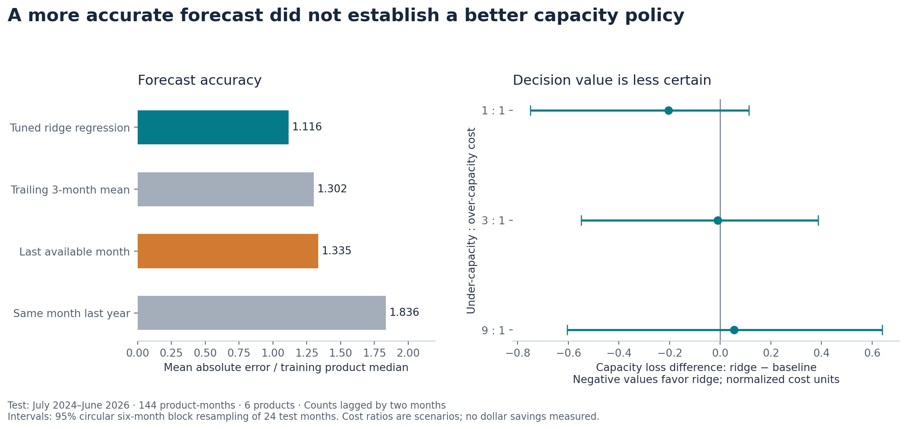
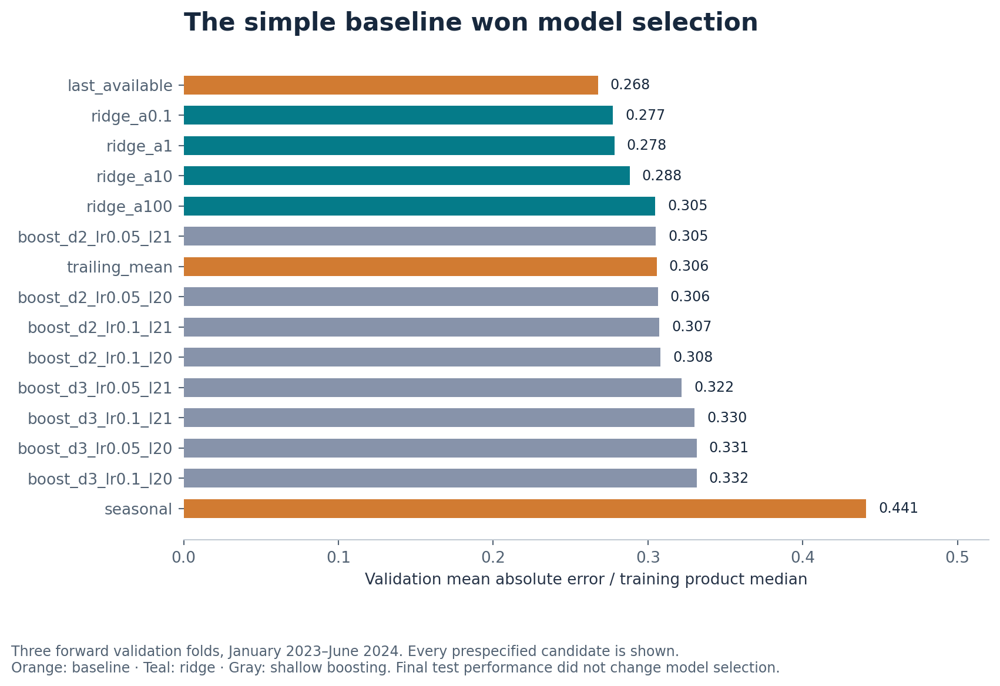

# Complaint demand: when a better forecast is not yet a better decision

**SQL · Python · time-series validation · model selection · decision analysis**

A financial-services operations team must choose review capacity before the incoming workload is known. This study asks whether improved prediction translates into a better capacity decision when shortages cost more than surplus capacity.

The strongest validated machine-learning candidate reduced final-test normalized absolute error by **16.4%** against the last-available-month rule. It did **not** establish a reliable advantage in the capacity-cost scenarios: all three block-resampling intervals for the paired loss difference included zero. The simple rule had won model selection on the earlier validation period.

**Recommendation:** retain the operational comparator and run a prospective shadow evaluation with actual handling times and agreed shortage costs before replacing it. No staffing savings or deployed impact are claimed.



## Evidence worth inspecting

| Capability | Implemented evidence |
|---|---|
| SQL and data engineering | Unique product–month keys, nonnegative-count constraints, lag windows and explicit source-month lineage; [SQL queries](sql/) |
| Source validation | 102 monthly snapshots reconcile to a separate 15,256,569-complaint whole-period query across all 14 buckets; [receipt](results/source_reconciliation.json) |
| Leakage control | Forward folds, train-only scaling/encoding, fixed initial-training normalization and a final 24-month test |
| Model tuning | Three baselines, four ridge penalties and eight boosting configurations, with every candidate retained |
| Decision analysis | Validation-residual capacity calibration, three asymmetric loss scenarios and paired monthly block resampling |
| Independent checking | A separate standard-library verifier recalculates lineage, selection, errors, quantiles and policy losses |

## Data and design

The source is the public [CFPB Consumer Complaint Database](https://www.consumerfinance.gov/data-research/consumer-complaints/), retrieved 28 October 2026. The release contains **aggregate counts only**. No complaint narratives, names, identifiers, addresses or individual records are retained.

Six consistently named categories are modeled over January 2018–June 2026: checking/savings, debt collection, money transfers, mortgages, student loans and vehicle loans. Feature-complete targets begin in January 2019. The initial training period ends in December 2022; three expanding six-month validation folds cover January 2023–June 2024; the final test covers July 2024–June 2026, or 144 product-months.

Primary features use counts at least two months old. A three-month delay is a prespecified sensitivity analysis. These are information-delay assumptions, **not historical release vintages**. Final-snapshot revisions can still affect retrospective evaluation.

See the [protocol](PROTOCOL.md), [source notes](SOURCES.md), [complete tuning table](results/lag2_tuning.csv), [predictions](results/lag2_test_predictions.csv) and [product-level errors](results/product_test_errors.csv).

### Primary results

| Model | Final-test normalized MAE |
|---|---:|
| Ridge, alpha 0.1 | 1.116 |
| Trailing three-month mean | 1.302 |
| Last available month | 1.335 |
| Same month last year | 1.836 |

The metric divides absolute error by each product's median count in the initial training period and then averages across product-months. It is not a percentage error. Ridge improves four of six product groups and worsens two. Its lower final-test error does not retroactively change the validation winner.

At a hypothetical 3:1 shortage-to-surplus cost ratio, mean normalized losses were **2.687 for ridge** and **2.697 for the baseline**. Their paired difference was −0.010, with a 95% six-month block-resampling interval of **[−0.550, 0.387]**. These are dimensionless scenarios, not dollars or measured business costs.



## Reproduce

Python 3.10 was used. Create an isolated environment, then run:

```bash
python -m pip install -r requirements.txt
python -m unittest discover -s tests -v
python src/check_reproduction.py
```

The reproduction command uses a disposable copy: it reruns both lag scenarios, independently checks the calculations and resampling intervals, compares every summary field with the released results, and regenerates all three figures. The published files remain unchanged. Numerical comparisons allow relative rounding of `1e-7` and absolute rounding of `1e-9`; this is a reproducibility tolerance, not a statistical decision threshold.

The [revision workflow](.github/workflows/verify.yml) runs these checks on pull requests and changes to `main`, using the retained aggregate snapshots. It has read-only permissions, a ten-minute limit and a standard public-repository runner. It makes no live source-data requests and uses no account secrets. Dependency installation requires internet access. Automated figure generation does not replace visual review or establish scientific validity.

To regenerate the artifacts in your own working copy instead:

```bash
python src/analyze.py
python src/verify.py
python src/verify_intervals.py
python src/figures.py
```

The `.gitattributes` file preserves snapshot and result bytes on every operating system. An initial Linux CI run caught Git's automatic line-ending conversion invalidating the recorded hashes; the original bytes were restored without changing the data values or results.

The retained snapshots make this an offline reproduction. To check the live source separately:

```bash
python src/reconcile_source.py
```

The live database may change after the recorded snapshot; a mismatch should be investigated rather than silently overwritten. `src/retrieve.py` caches existing months. Retrieve a new release in a separate copy to preserve the published snapshot.

## A useful failure caught before release

The API documentation described an exclusive maximum date. A same-day probe returned 5,453 complaints, demonstrating inclusive behavior in the live API. The first extraction therefore overlapped month boundaries and was rejected. The corrected extraction uses each month's last day, and its sums match the whole-period query exactly. Every displayed result was rerun from that corrected release.

## Limits and next experiment

Complaint counts reflect reporting and publication processes, not the prevalence of consumer harm. This six-product panel omits major renamed categories. The test has only 24 months, large surges and no institution-specific service times. Residual calibration pools products; the uncertainty intervals depend on the chosen six-month blocks. The analysis is observational and does not identify causes of complaint surges.

The next experiment would collect release vintages, evaluate product-specific calibration and use real operational cost estimates. This is an independent, AI-assisted research study. Code, source snapshots and independent checks are available for inspection. Manuscript drafts remain private.
